# Vibasic: phần mềm hỗ trợ quản lý tồn kho ứng dụng mô hình EOQ và ROP

    

Ứng dụng web quản lý kho theo lô cho một công ty đồ gỗ gia dụng. App ghi nhận nhập, xuất, kiểm kê và hàng lỗi đến từng sản phẩm có mã vạch riêng, xuất kho theo FIFO. Từ dữ liệu đơn hàng, app tự tính điểm đặt hàng lại (ROP) và lượng đặt hàng kinh tế (EOQ), rồi đề xuất mặt hàng cần bổ sung kèm số lượng. Đây là sản phẩm của chuyên đề thực tập tốt nghiệp tại Công ty TNHH Vibasic.

> **English summary.** A lot-based inventory management web app (ASP.NET Core 8 + React/TypeScript + SQL Server) for a wooden-kitchenware company. Every item carries its own barcode, issues follow FIFO, and stocktakes and defects are handled through approval workflows. A weekly job computes safety stock, reorder point (ROP) and economic order quantity (EOQ) from the last 4 weeks of orders. Low-stock alerts open the moment net stock falls to the ROP, and the manager turns the proposals into a purchase report grouped by supplier.

| Tổng quan kho | Đề xuất bổ sung hàng theo ROP, EOQ |
|---|---|
| 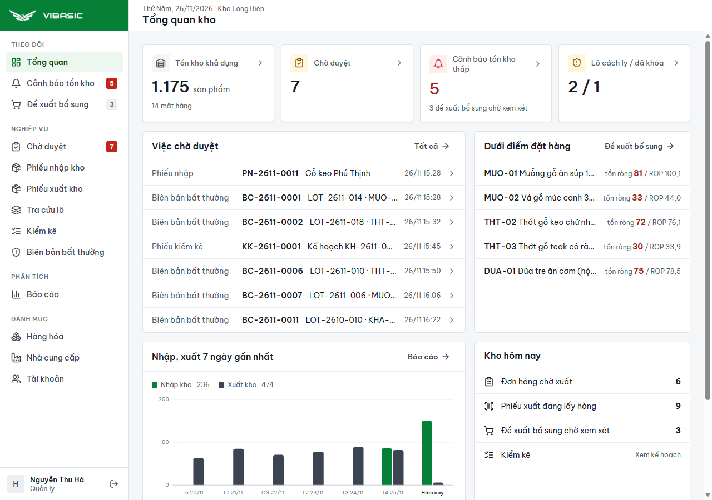 | 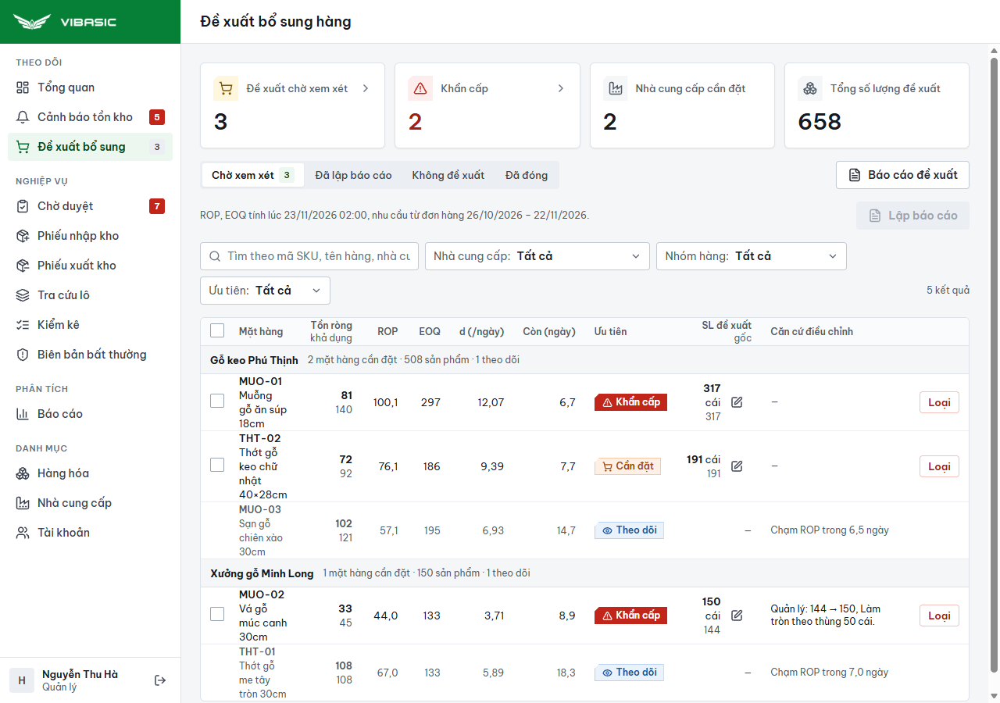 |

## Người dùng

Có hai vai trò, đều dùng app qua trình duyệt trên máy tính:

- **Quản lý:** duyệt chứng từ, theo dõi cảnh báo, xem xét đề xuất bổ sung và lập báo cáo.
- **Nhân viên kho:** nhập kho, lấy hàng, kiểm kê, báo hàng lỗi. Giao diện ưu tiên quét mã hơn gõ phím.

## Tính năng chính

**Nhập kho theo lô**
- Nhân viên lập phiếu nhập và kiểm tra chất lượng. Phần đạt thành lô "Bình thường"; phần không đạt tách thành lô "Tạm cách ly", có biên bản bất thường đi kèm.
- In tem mã vạch Code 128 cho từng lô và từng sản phẩm.
- Tồn kho chỉ được ghi nhận khi Quản lý duyệt phiếu.

**Xuất kho theo FIFO**
- Đơn hàng từ hệ thống bán hàng được phân bổ tự động vào lô nhập sớm nhất, và các sản phẩm được giữ chỗ.
- Có nhiều cách lấy hàng: quét tem sản phẩm, quét tem lô, "Lấy cả lô", "Chọn mã" và "Bỏ lấy". App từ chối mã không thuộc phiếu. Mỗi phiếu chỉ một nhân viên lấy tại một thời điểm.
- Nếu báo hàng lỗi khi đang lấy, app tự lập biên bản và thay bằng sản phẩm kế tiếp theo FIFO.
- Khi giao hàng, nhân viên ghi người nhận, số điện thoại và biển số xe.

**Kiểm kê**
- Kế hoạch kiểm kê toàn kho hoặc một số lô.
- Đếm bằng cách nhập số hoặc quét từng tem.
- Khi duyệt phiếu, tồn kho được điều chỉnh theo số đếm và sản phẩm thiếu được ghi nhận "Thất thoát".

**Biên bản bất thường**
- Lập khi nhập, xuất hoặc kiểm kê, cho từng sản phẩm lỗi hoặc cả lô.
- Quản lý duyệt kèm hướng xử lý: trả nhà cung cấp, tiêu hủy, thanh lý hoặc sửa chữa.
- Khi nhân viên xử lý xong, tồn kho được cập nhật theo hướng đã chọn.

**Hỗ trợ quyết định bổ sung hàng**
- Mỗi 02:00 thứ Hai, một job nền tính lại các chỉ số từ nhu cầu 28 ngày gần nhất:
  - d (nhu cầu bình quân ngày) và σ (độ lệch chuẩn của nhu cầu ngày);
  - SS (tồn kho an toàn) = z·σ·√L, với z = 1,65 và L là thời gian giao hàng (ngày);
  - ROP = d·L + SS;
  - EOQ = √(2DS/H), với D = 365·d là nhu cầu năm, S là chi phí mỗi lần đặt hàng, H là chi phí lưu kho một sản phẩm trong một năm.
- Sau mỗi thay đổi tồn kho hoặc đơn hàng, app so sánh tồn ròng (tồn khả dụng trừ đơn chưa xuất) với ROP để mở hoặc đóng cảnh báo.
- Số lượng đề xuất là ROP + EOQ − tồn ròng, không vượt nhu cầu 12 tuần. Mỗi đề xuất có mức ưu tiên Khẩn cấp, Cần đặt hoặc Theo dõi.
- Quản lý giữ, sửa (phải ghi lý do) hoặc loại đề xuất, rồi lập báo cáo đề xuất bổ sung gom theo nhà cung cấp để in.
- Mặt hàng chưa đủ 4 tuần dữ liệu hoặc 8 tuần không có đơn không được đề xuất.

**Báo cáo:** tổng quan kho, báo cáo tồn kho, báo cáo nhập – xuất – tồn; in được và xuất CSV.

## Công nghệ

| Phần | Công nghệ |
|---|---|
| `api/` | ASP.NET Core 8 Web API, Entity Framework Core 8, SQL Server, JWT, BCrypt, Cronos (job định kỳ), Swagger |
| `web/` | React 18, TypeScript, Vite, React Router, TanStack Query, JsBarcode; style bằng design system riêng (`design-system/vibasic-design`) |
| Kiểm thử | xUnit trên EF Core InMemory (93 test), ESLint |
| Tài liệu | UML (PlantUML, Mermaid), từ điển dữ liệu, hướng dẫn sử dụng |

## Kiến trúc

```
Trình duyệt (React, :5173) ──/api──▶ ASP.NET Core API (:5030) ──EF Core──▶ SQL Server "Vibasic" (22 bảng)
```

Web gọi API qua `/api/...`. Khi chạy dev, Vite chuyển các lời gọi này sang cổng 5030. API kiểm tra quyền bằng JWT, thực hiện quy tắc nghiệp vụ, rồi đọc và ghi SQL Server qua EF Core.

### `api/`: 4 project

| Project | Vai trò |
|---|---|
| `Vibasic.Domain` | 22 lớp dữ liệu (`Entities.cs`) và trạng thái (`Enums.cs`). Trạng thái lưu trong DB bằng nhãn tiếng Việt, ví dụ "Chờ lấy hàng". |
| `Vibasic.Infrastructure` | Toàn bộ quy tắc nghiệp vụ, mỗi nhóm một service: `Receiving` (nhập kho), `Issuing` (xuất kho FIFO, hủy đơn), `Stocktaking` (kiểm kê), `Abnormal` (biên bản bất thường), `Decision` (ROP, EOQ, cảnh báo, đề xuất), `Catalog` (danh mục). Kèm `VibasicDbContext`, `CodeGenerator` (mã phiếu, mã lô, mã sản phẩm), `Migrations` và `Seed` (dữ liệu mẫu). |
| `Vibasic.Api` | `Controllers/` nhận yêu cầu, kiểm tra vai trò rồi gọi service. `Auth/` cấp JWT. `ReplenishmentJob` là job nền tính lại ROP, EOQ hằng tuần. `Program.cs` tự áp migration khi khởi động. |
| `Vibasic.Tests` | 93 test xUnit cho các quy tắc nghiệp vụ. |

**Một số cách làm trong code**
- Controller không chứa logic. Mọi thay đổi tồn kho đi qua service, và sau khi lưu, service gọi `ReplenishmentService.CheckAsync` để mở hoặc đóng cảnh báo, đề xuất theo tồn ròng mới.
- Các công thức ROP, EOQ, mức ưu tiên và số lượng đề xuất nằm trong `ReplenishmentRules`, là các hàm thuần. Service và bộ sinh dữ liệu mẫu dùng chung các hàm này.
- Chống ghi đè khi hai người thao tác cùng lúc: EF Core concurrency token trên người lấy hàng, trạng thái chứng từ và sản phẩm được giữ chỗ. Người lưu sau nhận HTTP 409 kèm lời nhắc tải lại.
- Lỗi trả về theo hai loại: vi phạm quy tắc nghiệp vụ là HTTP 409 kèm câu báo nói rõ cần làm gì; lỗi nhập liệu là HTTP 400, báo lỗi theo từng trường.
- Thời gian lấy qua `IClock` nên test chạy với đồng hồ cố định. DB lưu giờ UTC; ngày nghiệp vụ và mã chứng từ theo giờ Việt Nam.

### `web/`

| Thư mục | Vai trò |
|---|---|
| `src/app/` | Phần dùng chung: `router.tsx`, `api.ts` (gọi API kèm JWT), `auth.tsx`, và hook gọi API theo nghiệp vụ (`issuing.ts`, `receiving.ts`, `stock.ts`, `decision.ts`…). |
| `src/features/` | Màn hình theo nghiệp vụ: `manager/`, `staff/`, `receiving/`, `issuing/`, `stocktake/`, `abnormal/`, `decision/`, `reports/`, `print/` (in tem, biên bản, báo cáo). |
| `src/design/` | Bộ component, màu và font chép từ `design-system/vibasic-design`. |

Đường dẫn trang: `/ql/...` cho Quản lý, `/kho/...` cho Nhân viên kho, `/in/...` cho trang in.

## Ảnh giao diện

Chụp ngày 26/11/2026 từ dữ liệu mẫu, khung 1280×900.

| | |
|---|---|
| 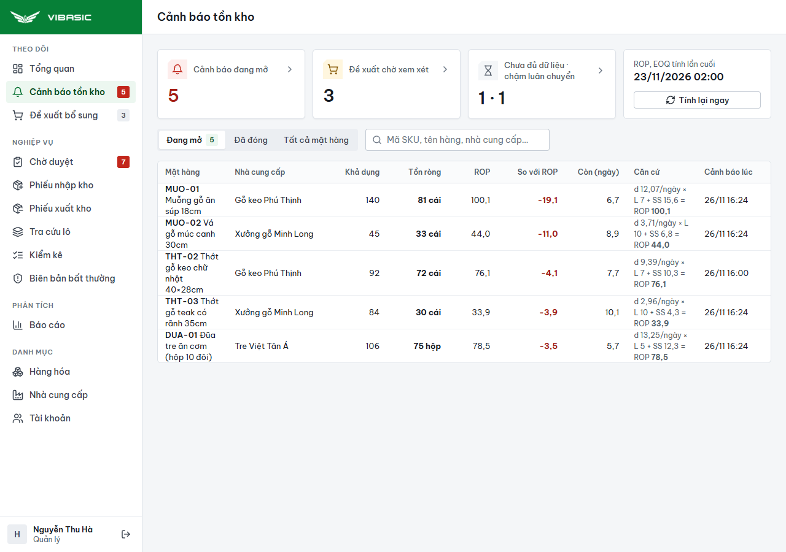 Cảnh báo tồn kho thấp | 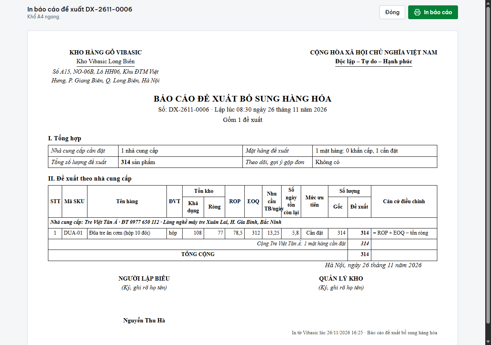 Báo cáo đề xuất bổ sung (bản in) |
| 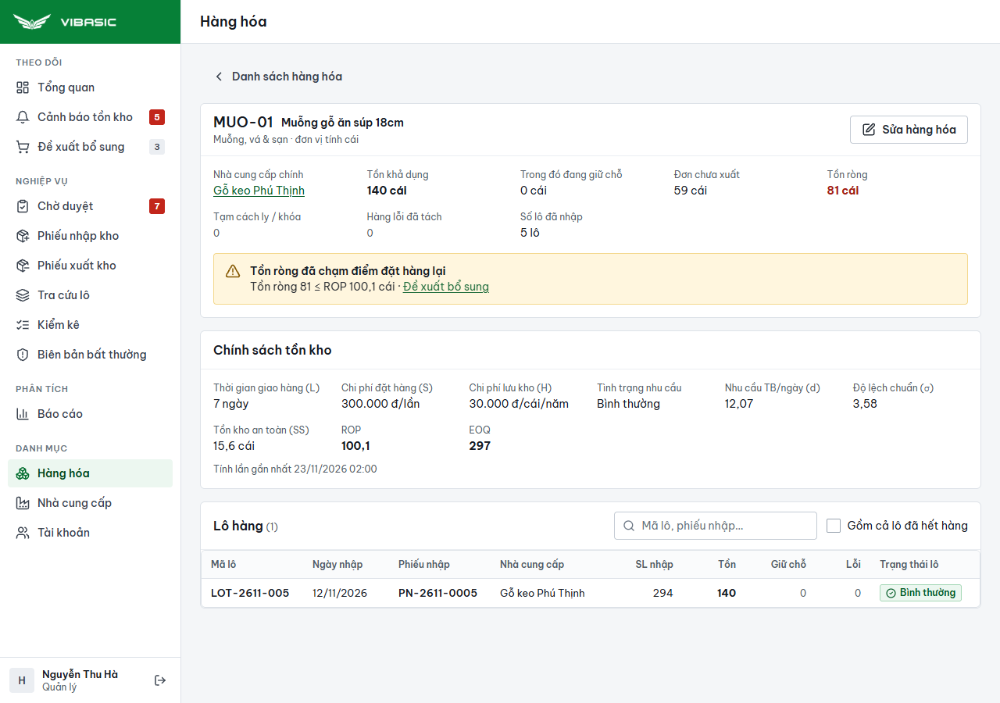 Chính sách tồn kho và ROP, EOQ của một mặt hàng | 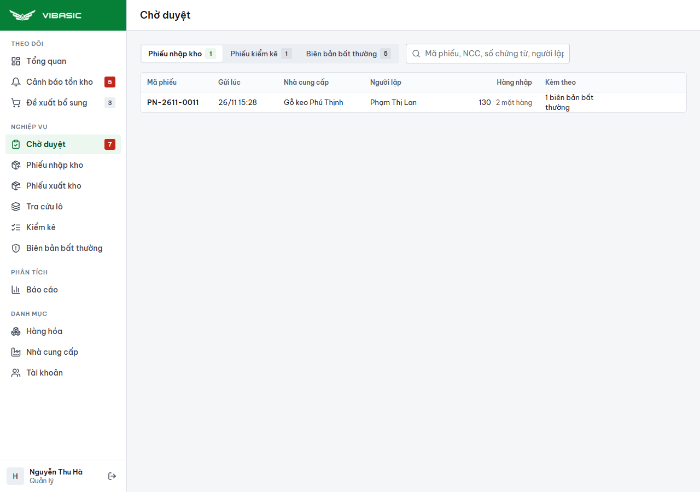 Việc chờ Quản lý duyệt |
| 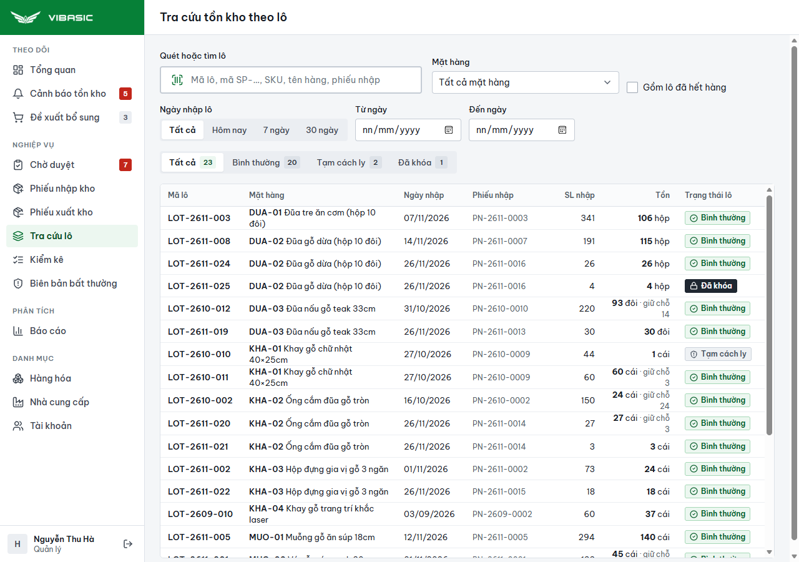 Tra cứu tồn kho theo lô | 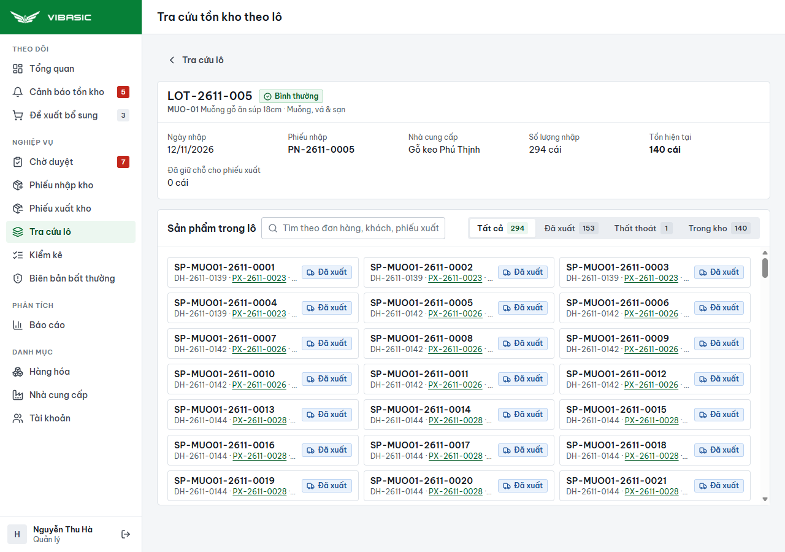 Chi tiết lô và từng sản phẩm |
| 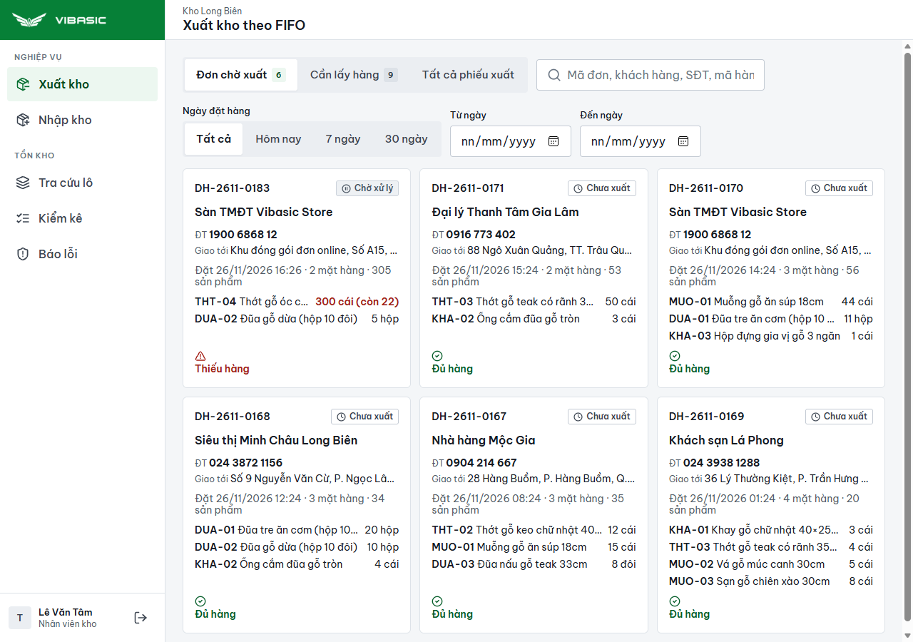 Nhân viên kho: đơn chờ xuất | 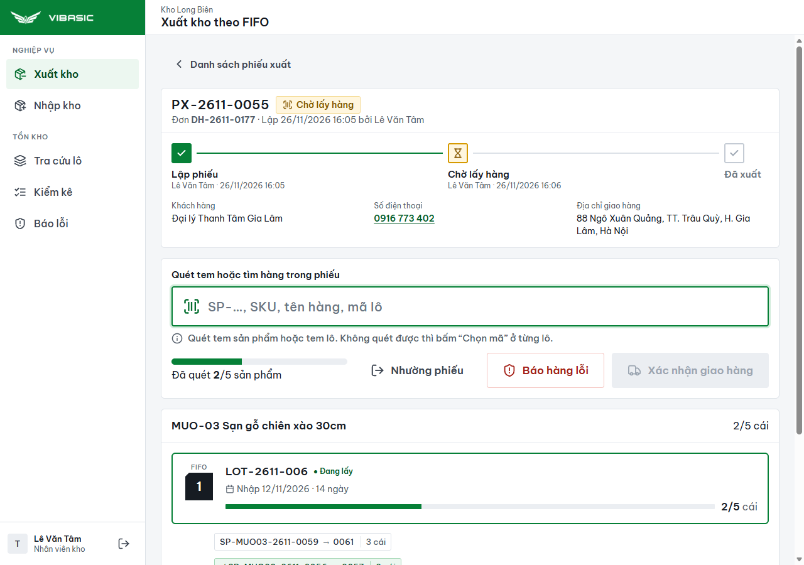 Nhân viên kho: lấy hàng theo FIFO |
| 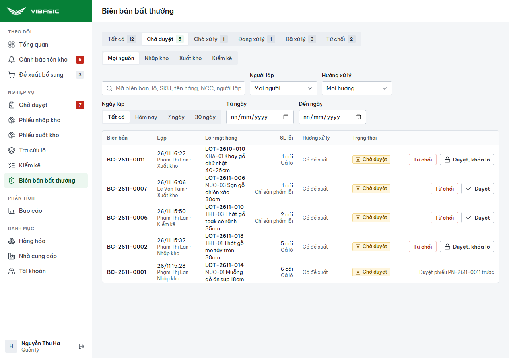 Biên bản bất thường | 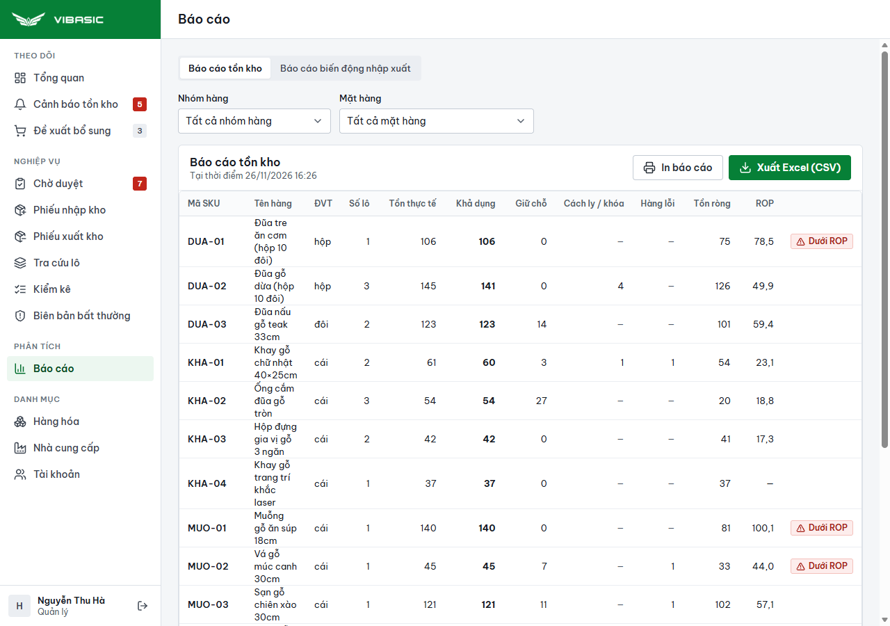 Báo cáo tồn kho |

Luồng màn hình của bốn nghiệp vụ chính nằm trong [docs/readme/quy-trinh/](docs/readme/quy-trinh/). Mỗi luồng có 4 bước:

| Nghiệp vụ | Các bước |
|---|---|
| Nhập kho | [Lập phiếu](docs/readme/quy-trinh/nhap-1-lap-phieu-nhap.png) → [Phiếu sau khi lưu](docs/readme/quy-trinh/nhap-2-phieu-nhap-sau-khi-luu.png) → [In mã vạch](docs/readme/quy-trinh/nhap-3-in-ma-vach.png) → [Quản lý duyệt](docs/readme/quy-trinh/nhap-4-duyet-phieu-nhap.png) |
| Xuất kho | [Đơn chờ xuất](docs/readme/quy-trinh/xuat-1-don-hang-cho-xuat.png) → [Lập phiếu theo FIFO](docs/readme/quy-trinh/xuat-2-lap-phieu-xuat-fifo.png) → [Lấy hàng](docs/readme/quy-trinh/xuat-3-lay-hang.png) → [Xác nhận giao hàng](docs/readme/quy-trinh/xuat-4-xac-nhan-giao-hang.png) |
| Kiểm kê | [Lập kế hoạch](docs/readme/quy-trinh/kiemke-1-lap-ke-hoach.png) → [Kiểm đếm](docs/readme/quy-trinh/kiemke-2-kiem-dem.png) → [Duyệt phiếu](docs/readme/quy-trinh/kiemke-3-duyet-phieu.png) → [Phiếu đã duyệt](docs/readme/quy-trinh/kiemke-4-phieu-da-duyet.png) |
| Hàng bất thường | [Báo hàng lỗi](docs/readme/quy-trinh/batthuong-1-bao-hang-loi.png) → [Duyệt biên bản](docs/readme/quy-trinh/batthuong-2-duyet-bien-ban.png) → [Xử lý](docs/readme/quy-trinh/batthuong-3-xu-ly-bien-ban.png) → [Đã xử lý](docs/readme/quy-trinh/batthuong-4-bien-ban-da-xu-ly.png) |

## Chạy trên một máy mới

### 1. Cài phần mềm (một lần)

| Phần mềm | Tải ở đâu | Kiểm tra bằng lệnh |
|---|---|---|
| Git | git-scm.com | `git --version` |
| .NET 8 SDK | dotnet.microsoft.com/download/dotnet/8.0 (chọn **SDK**, không phải Runtime) | `dotnet --version` ra `8.x` |
| Node.js 20 trở lên | nodejs.org (bản LTS) | `node -v` |
| SQL Server LocalDB | Trình cài SQL Server Express, chọn **Download Media**, chọn **LocalDB**. Máy có Visual Studio thường đã có sẵn. | `sqllocaldb info` có dòng `MSSQLLocalDB` |

### 2. Tải code về

```powershell
git clone https://github.com/Blessindisguise/vibasic.git
cd vibasic
```

### 3. Chạy API (cửa sổ PowerShell thứ nhất)

```powershell
cd api
dotnet run --project Vibasic.Api --launch-profile http
```

Lần chạy đầu, lệnh này tải thư viện, tạo DB `Vibasic` trên `(localdb)\MSSQLLocalDB` và nạp dữ liệu mẫu, mất khoảng một phút. API sẵn sàng khi thấy dòng `Now listening on: http://localhost:5030`. Swagger ở `http://localhost:5030/swagger`. Giữ cửa sổ này mở.

### 4. Chạy web (cửa sổ PowerShell thứ hai)

```powershell
cd web
npm install      # chỉ cần lần đầu, hoặc khi package.json thay đổi
npm run dev
```

Mở `http://localhost:5173` rồi đăng nhập bằng một tài khoản mẫu bên dưới.

### Tài khoản mẫu (mật khẩu `Vibasic@123`)

| Tên đăng nhập | Họ tên | Vai trò |
|---|---|---|
| `quanly` | Nguyễn Thu Hà | Quản lý |
| `nhanvien1` | Lê Văn Tâm | Nhân viên kho |
| `nhanvien2` | Phạm Thị Lan | Nhân viên kho |

### Tùy chọn

- **Dùng SQL Server khác:** đặt biến môi trường `ConnectionStrings__Vibasic`, ví dụ `Server=.\SQLEXPRESS;Database=Vibasic;Trusted_Connection=True;MultipleActiveResultSets=true;TrustServerCertificate=True`.
- **Khóa JWT:** `Jwt:Key` trong `appsettings.json` chỉ dùng khi phát triển. Khi triển khai thật, đặt khóa khác qua biến môi trường `Jwt__Key`.
- **Mở từ máy khác trong cùng mạng:** chạy `npm run dev -- --host`, rồi mở địa chỉ `Network: http://192.168.x.x:5173` mà lệnh in ra. Nếu Windows hỏi về tường lửa cho Node.js, cho phép trên mạng riêng (Private).
- **Lấy code mới:** chạy `git pull` rồi chạy lại API. API tự áp migration mới và giữ nguyên dữ liệu. Nếu `package.json` thay đổi thì chạy lại `npm install`.
- **Nạp lại dữ liệu mẫu từ đầu** (lệnh này **xóa hết dữ liệu** trong DB): dừng API, chạy lệnh dưới đây, rồi chạy lại API.

  ```powershell
  cd api; dotnet tool restore; dotnet ef database drop -f -p Vibasic.Infrastructure -s Vibasic.Api
  ```

## Dữ liệu mẫu

Dữ liệu mẫu được sinh lùi từ ngày chạy seed nên luôn còn mới. Tên doanh nghiệp, khách hàng và nhà cung cấp đều là tên hư cấu.

- **Kho và danh mục:** một kho ở Long Biên, Hà Nội; 14 mặt hàng thuộc 4 nhóm hàng; 3 nhà cung cấp ở các làng nghề gỗ quanh Hà Nội. Có 1 mặt hàng mới nhập 10 ngày ("Chưa đủ dữ liệu") và 1 mặt hàng 8 tuần không có đơn ("Chậm luân chuyển").
- **Lịch sử 12 tuần vận hành**, chạy theo đúng quy tắc của app:
  - tồn đầu kỳ nhập ngày đầu tiên;
  - đơn hàng tiếp nhận chiều hôm trước, xuất kho theo FIFO;
  - mỗi thứ Hai tính lại SS, ROP, EOQ;
  - đề xuất được tạo khi tồn ròng ≤ ROP. Quản lý mẫu lập báo cáo (có lúc sửa số lượng) hoặc loại đề xuất, và hàng về sau thời gian giao hàng.
  - Tổng cộng khoảng 30 phiếu nhập, gần 8.000 sản phẩm có mã riêng, khoảng 175 phiếu xuất và 25 đề xuất ở đủ các trạng thái. Đề xuất của 5 ngày gần nhất để trống cho người dùng tự xem xét.
- **24 tình huống đang dở của hôm nay** (`Seed/DemoScenarios.cs`), dựng bằng chính các service nghiệp vụ để mọi trạng thái đều có mẫu:
  - **Nhập kho:** phiếu đang nhập, chờ duyệt (có lô cách ly và dòng lệch chứng từ), bị từ chối; lô không đạt bị khóa, đã trả nhà cung cấp hoặc đang chờ tiêu hủy.
  - **Xuất kho:** phiếu chờ lấy hàng, đang lấy dở, đã quét đủ chờ giao, đã giao; một phiếu lấy hết lô FIFO đầu (để thử "Lấy cả lô", "Chọn mã"); đơn bị hủy khi đang lấy; đơn chờ xử lý vì thiếu hàng.
  - **Biên bản bất thường:** đủ ba nguồn (nhập, xuất, kiểm kê) và đủ các trạng thái: chờ duyệt, chờ xử lý, đang xử lý, đã xử lý (rời kho hoặc sửa xong về kho), từ chối.
  - **Kiểm kê:** kế hoạch chờ thực hiện; phiếu chờ duyệt có lô dư; phiếu đã duyệt có sản phẩm thất thoát; phiếu bị từ chối.

Các tình huống demo chỉ chạy khi API vừa tạo DB mới, không chạy trong test.

## Tài liệu

- [Hướng dẫn sử dụng](docs/huong-dan-su-dung.md): quy tắc, trạng thái và cách thao tác.
- [Từ điển dữ liệu](docs/tu-dien-du-lieu.md): 22 bảng, từng cột, màn hình nào dùng bảng nào, quy trình từng bước. Ảnh trong tài liệu này nằm ở `docs/anh-giao-dien/`, chụp ngày 11/11/2026 trên bản dữ liệu mẫu cũ.
- [Thay đổi so với CSDL trong báo cáo](docs/schema-changes.md).
- Sơ đồ lớp: [ảnh](docs/so-do-lop.png), [PlantUML](docs/so-do-lop.puml), [Mermaid](docs/so-do-lop.mmd).
- Sơ đồ hoạt động (PlantUML): [nhập kho](docs/so-do-hoat-dong-nhap-kho.puml), [xuất kho](docs/so-do-hoat-dong-xuat-kho.puml), [kiểm kê](docs/so-do-hoat-dong-kiem-ke.puml), [xử lý biên bản bất thường](docs/so-do-hoat-dong-bat-thuong.puml), [hủy đơn hàng](docs/so-do-hoat-dong-huy-don.puml).

## Kiểm thử

```powershell
cd api; dotnet test Vibasic.Tests      # 93 test quy tắc nghiệp vụ
cd web; npm run build; npm run lint    # kiểm tra kiểu TypeScript, build, lint
```

## Quá trình phát triển

Từ giai đoạn 2, code được làm trên nhánh phụ (`giai-doan-2`, `giai-doan-3`), chạy hết test rồi mới gộp vào `main` qua pull request.

| Giai đoạn | Nội dung |
|---|---|
| 1 | Nền tảng: CSDL theo sơ đồ lớp, dữ liệu mẫu, đăng nhập JWT, khung giao diện cho hai vai trò |
| 2 | Danh mục (UC_01–03) và chính sách tồn kho |
| 3 | Nhập kho (UC_04–06), duyệt phiếu nhập (UC_10), biên bản cho lô cách ly khi nhập (UC_12) |
| 4 | Xuất kho FIFO (UC_07–09), báo hàng lỗi khi xuất |
| 5 | Biên bản bất thường, kiểm kê, tra cứu lô (UC_11–16) |
| 6 | ROP, EOQ, cảnh báo, đề xuất (UC_17–18) |
| 7 | Báo cáo và tổng quan (UC_19) |
| 8 | Hủy đơn hàng (UC_20), đề xuất theo bộ quy tắc Q1–Q20, báo cáo đề xuất; phiếu xuất không cần duyệt; CSDL chốt 22 bảng |
| 9 | Xử lý biên bản sau khi duyệt (hướng xử lý, cập nhật tồn); lấy hàng không cần quét ("Lấy cả lô", "Chọn mã", "Bỏ lấy"); giao hàng ghi số điện thoại, biển số xe; dữ liệu demo đủ mọi trạng thái; sơ đồ hoạt động PlantUML |
